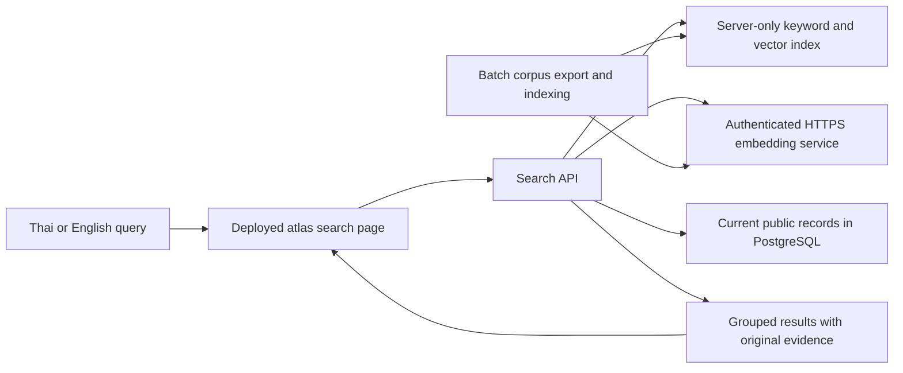

# Feature Technical Design

## Atlas-wide Thai–English Search

HRI Hackathon Thailand 2026 · First-screening proposal · 22 October 2026

Status: proposed design. Model performance, indexing throughput and deployed operation remain untested. The accompanying [Feature Implementation Hack Day Plan](Hack-day-planning/feature-implementation-hack-day-plan.md) defines the six-hour delivery schedule and acceptance checks.

## 1. Search behavior and data limits

The feature will retrieve related public robotics information from across Thailand Humanoid Atlas through one `/search` page. Thai, English and mixed-language queries will search the same corpus. Results will retain their original language and identify whether they are papers, repositories, videos, news/web sources, robot models, contributions, perspectives, public inventory, relationships or entities.

The feature searches stored titles, descriptions, excerpts and selected metadata. It will present source text alongside the result so users can inspect the match. Relevance scores will remain internal; the interface will describe results as related information and show the search mode in use.

The checked-in seed contains 6,749 entries, including 6,714 source records and 16 robot models. Among the source records, 121 contain Thai characters in the title or imported excerpt, and 2,759 excerpts contain an OpenAlex abstract placeholder. These counts describe the seed file. The indexed corpus will depend on the database used for the release and its public-data policy.

The placeholder `OpenAlex abstract metadata available.` will be omitted from retrieval text. Such records will remain searchable through their titles and permitted metadata, with a `title/metadata only` label. Repository descriptions, video descriptions and catalog summaries will be identified by their stored field type. The build will not acquire complete papers, repository code or video transcripts.

## 2. Components and technology choices

| Component | Proposed technology | Purpose |
| --- | --- | --- |
| Search page | Existing Next.js 15, React 19 and TypeScript | Add a global page with typed results, filters and bilingual interface labels. |
| Search API | Next.js Node runtime and existing Zod | Validate requests, coordinate retrieval and check current record eligibility. |
| Authoritative data | Existing Prisma/PostgreSQL | Read selected public fields and validate candidate records before display. |
| Keyword retrieval | MiniSearch and native `Intl.Segmenter` | Search names, titles and stored text with Thai-aware word segmentation. |
| Semantic retrieval | `Qwen/Qwen3-Embedding-0.6B`, 1,024 dimensions | Convert records and queries into vectors for cross-language and paraphrase retrieval. |
| Model service | Hugging Face Text Embeddings Inference (TEI) | Serve embeddings from the team's GPU machine through an authenticated HTTP interface. |
| Search index | Metadata JSON, Float32 vector file and release manifest | Package a versioned index with the website without a schema migration or separate vector database. |

Qwen0.6B is the first model candidate. The team will check its quality and resource use on the available RTX 3080 Mobile / 8 GB machine. If TEI cannot run in the verified environment, one Sentence Transformers/FastAPI service can provide the same embedding interface. The selected runtime, model revision and configuration will be recorded before indexing.

The browser will receive result text and references. Model credentials, vectors and internal ranking scores will stay on the server.

## 3. Public content model

Direct, paginated database reads will produce a common search-document format. The export will cover every eligible public record kind and report empty categories. Graph-derived loaders will not supply the corpus because their record limits and inferred relationships could omit or alter searchable content.

| Record kind | Selected searchable fields | Eligibility rule |
| --- | --- | --- |
| Source | Title, substantive excerpt, bibliographic author and platform | Accepted external metadata from permitted public origins under an explicit release policy. Unknown or submission-derived origins require specific admission. |
| Robot | Canonical name, description, manufacturer/developer, country and category | Public catalog projection with explicit exclusions. The initial index omits `primaryUseCase`, which can contain imported editorial notes. |
| Contribution | Title, description, public contributor/organization, type and stored license | Public visibility and approved workflow status. Related robot text inherits that robot's eligibility. |
| Perspective | Evidence excerpt, theme, target, stance/sentiment, method and parent title | Current parent source must remain eligible. Annotation labels remain distinct from source excerpts. |
| Inventory | Public display name, eligible model name, ownership/condition labels and designated public organization | Explicit public visibility. Custodian, location, serial, acquisition details, notes and arbitrary JSON are excluded. |
| Relationship | Subject, relation, object and source reference | Eligible parent source or a documented public-release exception. Display as a stored assertion. |
| Entity/organization | Name, entity type and explicit provenance | Validated source association or a documented public-release exception. Similar names do not establish identity or provenance. |

The release policy will record permitted origins, public fields, visibility/status conditions, excluded typed references and documented exceptions. Bulk publication of selected metadata is separate from manual factual review. Imported `ACCEPTED` or `APPROVED` values describe workflow state; they do not certify a claim's accuracy.

Users, private inventory, unpublished submissions, contact details, jobs, pipeline records and caches will remain outside the corpus. Raw provider payloads, `rawMeta`, `sourceMeta` and reviewer notes will not be copied wholesale into the index. The release will reuse the atlas's shared public-data policy where available.

Each search document will contain:

| Field | Role |
| --- | --- |
| Typed reference | Record kind plus database ID, retained independently of vector position. |
| Content type and title | Result label and searchable title/name. |
| Retrieval text | Selected public metadata and up to 2,000 Unicode code points of body text. |
| Evidence | Original field name, text, label, coverage and original-text range. |
| Source URL and group identity | Provenance and exact duplicate/source grouping. |
| Public-field and dependency hashes | Detect changed content, eligibility or parent/joined fields. |
| Vector row | Internal offset into the binary index, or null for an unembedded document. |

Original strings will be preserved. Evidence ranges will use UTF-16 offsets into the original field, while the indexing limit will count Unicode code points. Truncated bodies will carry a partial-text label.

## 4. Index construction and updates

The exporter will read the complete eligible corpus through pagination, apply the public-field rules, remove known placeholders and classify source types. Recognized platform, explicit source type and conservative URL patterns will guide classification; unknown content will retain a generic source label. This accounts for imported OpenAlex, GitHub and YouTube rows that may be labelled `WEB`.

The team will generate corpus vectors in batches through the selected embedding service. Document inputs will use the public retrieval text without a query instruction. Query inputs will use Qwen's instruction format with the task: `Given a Thai or English robotics information request, retrieve relevant public atlas records.`

The profile will pin model revision, serving runtime, pooling, numeric precision, dimensions, normalization and preprocessing. The service adapter will check vector dimensions, finite values and nonzero norm, then normalize vectors. Corpus and query vectors must use the same profile. A compatibility probe will detect an unexpected service configuration.

Each index release will contain three server-only files:

| File | Contents |
| --- | --- |
| `documents.json` | Public search documents, evidence references and vector-row mapping. |
| `vectors.f32` | Normalized vectors encoded as little-endian Float32 values. |
| `manifest.json` | Release identifier/time, model/policy/corpus hashes, file checksums and sizes, ordered record-key hash and coverage by kind. |

A keyword-only release can contain zero vector rows and an empty binary. That release will declare semantic coverage as absent. A release with some completed vectors will declare partial coverage.

For scale, 6,749 vectors at 1,024 Float32 dimensions occupy approximately 27.6 MB before metadata and runtime overhead. The actual document count will differ with eligibility and record grouping. Hosted bundle size, cold loading and indexing throughput will be measured during implementation.

The builder will validate a staged file set before promotion. Checkpoints will be reused only when content and model-profile hashes match. One completed release will be packaged with the hosted application, with explicit server tracing for its files and policy/profile configuration. Model weights and temporary checkpoints will remain outside the repository and browser assets.

New records and changed public text will enter retrieval after export, rebuild and redeployment. The interface will show the index timestamp. Before displaying a candidate, the API will read its current database projection and dependencies, reapply eligibility and compare hashes. It will suppress deleted, hidden, changed or newly ineligible records until a compatible rebuild. Current withdrawals therefore take effect on the next request, including after rollback.

## 5. Retrieval and result grouping

The API will normalize a separate query copy using Unicode NFKC, whitespace normalization and Latin case folding. Original Thai marks and negation will remain intact. `Intl.Segmenter` will provide the same word-tokenization behavior for indexed text and queries.

The initial retrieval settings are:

| Setting | Initial value |
| --- | --- |
| Exact full title/name | Highest priority |
| MiniSearch field weights | Title/name 4; body 1 |
| Fuzzy matching | At most one edit for Latin tokens of five or more letters; Thai fuzzy expansion deferred |
| Semantic scoring | Exact cosine similarity over compatible normalized vectors |
| Combined ranking | Reciprocal rank fusion, `sum(1 / (60 + rank))` |
| Initial candidates | 50 per retrieval branch |
| Current-record checks | At most 200 candidates per request while filling results |

Type filters will apply to document members before scoring and candidate limits. Generic/function words will be excluded from lexical eligibility only. A descriptive keyword result must match a remaining meaningful token or phrase. Blank or generic-only input will return a labelled browse view without a query-match claim. The embedding input will retain the full normalized request, including negation.

Development queries will determine a semantic acceptance cutoff tied to the selected profile. Until that policy is available, the API will declare keyword mode. The final policy will be frozen before the reserved evaluation cases are run.

The API will group records through an exact canonical external identity or explicit parent-source association. A source, its perspective and its stored relationship may therefore share one result group while retaining distinct evidence. Duplicate entries will use the best surviving member score. Robots will retain their own identity when an article links to their manufacturer.

Records without an external or parent identity will retain a singleton `kind:id` group. Empty URLs and similar titles will not merge records. After current-record checks, only surviving members of the selected types can qualify, score or supply evidence for a group.

The interface will show related information with original evidence. A partial association may remain relevant to a complex request even when another requested condition is unsupported; the displayed text must let the user inspect that gap. The pilot will include unrelated, partial and negated requests. The feature will make no suitability or complete Boolean-constraint claim.

## 6. API and interface behavior

The planned endpoint is `POST /api/search` with `query`, optional `types` and optional `limit` fields.

| Request constraint | Value |
| --- | --- |
| Nonblank query length | 1–300 Unicode code points after trimming |
| Blank query | Current eligible browse results, without model inference |
| Result limit | 1–20 groups; default 10 |
| JSON body | At most 8 KiB |
| Inference deadline | 2.5 seconds |
| Total request budget | Five seconds |

Responses will identify search mode (`hybrid`, `keyword` or `unavailable`), view (`results` or `browse`), release ID/time, semantic coverage, warning codes and grouped results. Results will include typed references, content labels, original evidence and available source links. Browse results will have no match reason.

The `/search` page will be reachable from desktop and mobile navigation. Users can submit with Enter or a button, filter by content type and restore query/filter state through the URL. The client will cancel or ignore superseded requests. Clearing a query will fetch current eligible browse data rather than restore an old result list.

Interface labels will follow the selected Thai/English language. Original content will retain its language. Source text will render as plain text; external links will allow HTTP(S) URLs without embedded credentials. Longer fields can expand inline when no exact atlas detail route is available. Literal highlighting will be used only where the matched text range is known.

| Failure | User-visible behavior |
| --- | --- |
| Model timeout, rejected credentials, overload or incompatible profile | Keyword results with a visible warning that semantic and cross-language coverage are reduced. |
| Partial vector index | Available retrieval continues with an explicit partial-coverage label. |
| Missing semantic acceptance policy | Keyword mode until a profile-compatible policy is available. |
| Missing/invalid release or failed current eligibility checks | Unavailable state without cached candidate text. |
| No qualifying result | Empty result state without padding the list. |

These deadlines are proposed operating limits. They are not measured latency results or an uptime guarantee.

## 7. Deployed service and operations

The hosted Next.js server will call the team's embedding service through authenticated HTTPS. TEI will run on the RTX 3080 Mobile / 8 GB machine after driver, runtime and memory checks. A tunnel may provide ingress without a public IP. The embedding service will retain its own authentication, bounded requests and concurrency controls.

The initial service limit will be four active requests, subject to measurement. Credentials will remain server-side, raw queries will not be logged by default, and shared gateway throttling will protect public access. Model weights will be cached, and the operating notes will cover process restart and health checks.

The website and index will use the normal hosted build, with the required server files included explicitly. The team will verify the actual deployed database connection, binary file loading and model call from another network. During judging, the GPU machine and its network connection must remain available. Continued operation will need an always-on embedding endpoint; the documented model profile and release format will support moving that endpoint later.

## 8. Validation and evidence

The [Hack Day Plan](Hack-day-planning/feature-implementation-hack-day-plan.md) assigns the 20-query pilot, reserved-query split and release checkpoints. Evaluation will compare keyword, semantic and combined retrieval using judged candidate evidence. Real Thai-text source candidates will be checked in the eligible database so tests can cover English-to-English, Thai-to-English, English-to-Thai and Thai-to-Thai retrieval where the data supports them. Translation fixtures will remain separate from real-data results.

Correctness checks will cover every public adapter, type filters, duplicate grouping, null-source identities, vector/profile validation, current parent eligibility, stale content, API limits and cancelled requests. Browser checks will cover mixed results, original text, language labels, keyboard/mobile controls and model outage/recovery. The team will also run type checking and a production build.

The delivery record will identify the tested commit, deployed URL, model/index/policy versions, eligible and indexed counts by kind, pilot outcomes, observed latency, failures and untested behavior. Partial semantic coverage will be reported as incomplete atlas-wide semantic delivery.

## References

- [HumanoidTH database schema](https://github.com/taechasith/HumanoidTH/blob/bef80bdfe895f9403af910951fa251c9baacad2b/prisma/schema.prisma), [seed dataset](https://github.com/taechasith/HumanoidTH/blob/bef80bdfe895f9403af910951fa251c9baacad2b/thailand_humanoid_atlas_seed_records.json), [seed importer](https://github.com/taechasith/HumanoidTH/blob/bef80bdfe895f9403af910951fa251c9baacad2b/lib/seed-importer.ts) and [ingestion adapters](https://github.com/taechasith/HumanoidTH/blob/bef80bdfe895f9403af910951fa251c9baacad2b/lib/ingest/adapters.ts) document the baseline data, fields and import behavior used in this proposal.
- [Qwen3-Embedding](https://github.com/QwenLM/Qwen3-Embedding), [TEI](https://huggingface.co/docs/text-embeddings-inference/quick_tour) and [MiniSearch](https://lucaong.github.io/minisearch/) document the proposed retrieval components.
- [Next.js 15 output tracing](https://nextjs.org/docs/15/app/api-reference/config/next-config-js/output) and [Cloudflare Tunnel](https://developers.cloudflare.com/tunnel/) document server-file packaging and an ingress option for the team's model service.
