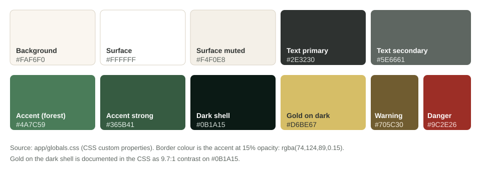
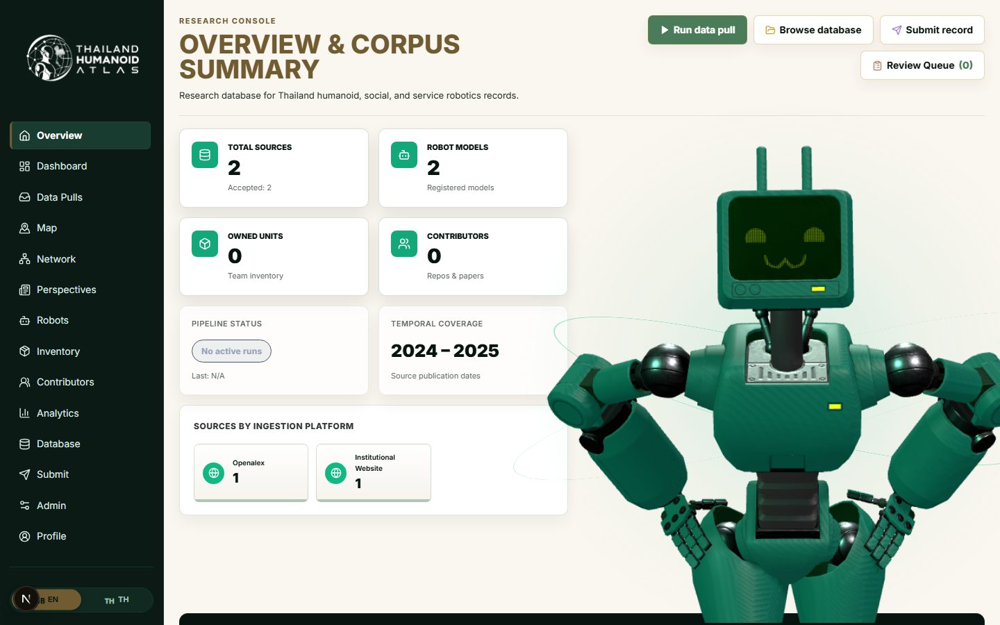
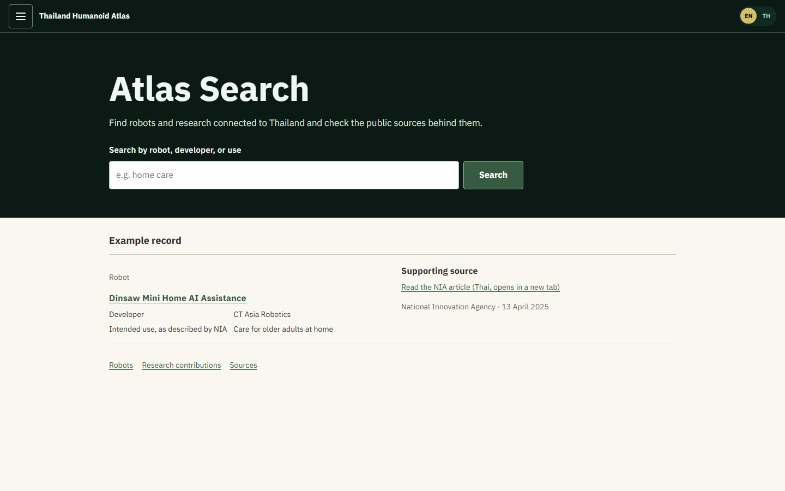
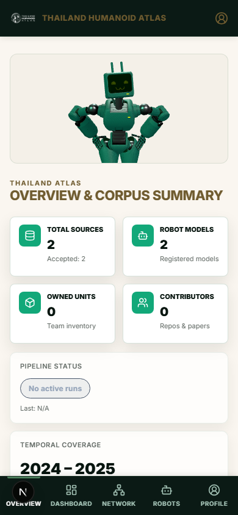
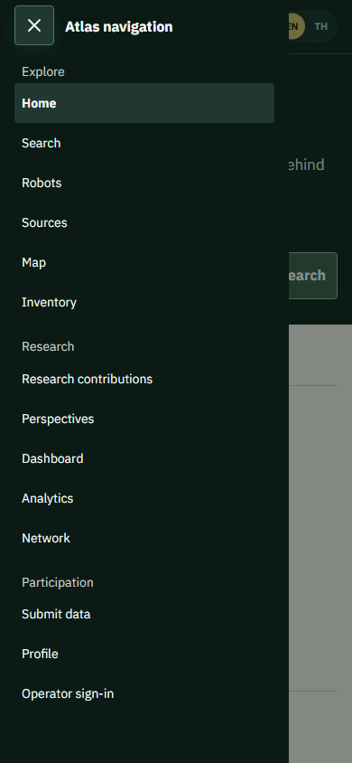
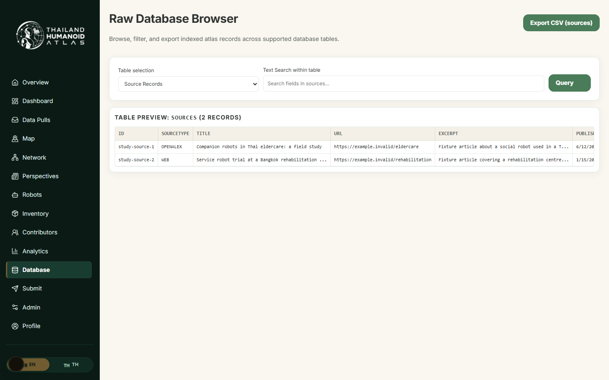
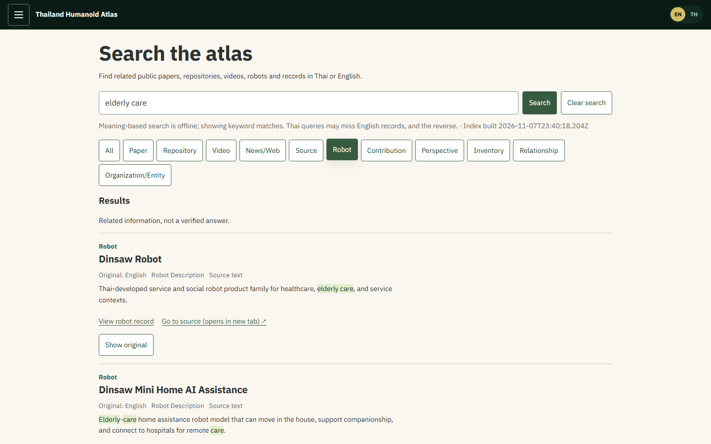

# Mood board and corporate identity: Thailand Humanoid Atlas

A one-page visual reference for the Atlas UI revamp. Everything below is taken from the repository or from the screenshots in `docs/design/img/`; nothing is a new brand invented for the submission. Context and evidence: [UI/UX revamp description](../ui-ux-revamp.md).

## Mood in four words

**Calm. Grounded. Evidence-first. Bilingual.** The CSS tokens describe the palette in these terms: "warm organic cream", "terra forest green", "grounded desaturated warm charcoal" (`app/globals.css`). The revamp keeps that identity and changes the order of the screen: the visitor's task (search) comes first, the operator's tools do not.

## Identity (CI)

| Element | What the product uses | Source |
|---|---|---|
| Name | Header wordmark follows the language: "Thailand Humanoid Atlas" (EN) and "คลังข้อมูลหุ่นยนต์มนุษย์ประเทศไทย" (TH) | `app/components/AtlasNavigation.tsx`, [after-home capture](img/after-home-desktop-1440-en.png) |
| Mark | Globe-and-robot logo with "THAILAND HUMANOID ATLAS" lettering | `public/logo.png` (below) |
| Colours | Cream surfaces, forest green accent, dark green shell, gold for text and icons on the shell | `app/globals.css`, palette below |
| Type | IBM Plex Sans for Latin text, IBM Plex Sans Thai for Thai | `app/layout.tsx` (`next/font/google`), `app/globals.css` |
| Language | EN / TH switch in the header, visible in every capture | [Thai home](img/after-home-mobile-390-th.png) |
| Shape and motion | Soft border (accent at 15%), soft shadow, one easing curve (`cubic-bezier(0.2, 0.8, 0.2, 1)`) | `app/globals.css` |

## Typography

IBM Plex Sans (Latin) and IBM Plex Sans Thai (Thai) are loaded through `next/font/google`, with system sans-serif fallbacks. Using one family with a matching Thai companion keeps Thai and English headings at the same visual weight. Large headings are plain sentence case in the revamp (for example "Atlas Search"); the baseline used heavy uppercase headings, which the audit flagged.

## References we borrowed from

From the UI/UX audit of 7 November 2026 (`design-plans/2026-11-07-hri-atlas-ui-ux-audit.md`). Each reference had one job:

| Reference | What we took from it |
|---|---|
| Wikipedia (multilingual portal) | A direct search input as the entry point, language choice visible, specific recovery copy when nothing matches |
| IEEE Robots Guide (Explore Robots) | A fast route from intent to named robot models; show active scope and result count together |
| Our World in Data (Grapher) | Evidence is part of the record: source identity and date sit next to the claim |
| Data Commons (Place Explorer) | A plain search plus concrete examples, so the entry makes sense before anyone types |

## Before and after

| Before (baseline, audit captures) | After (revamp, development captures) |
|---|---|
|  |  |
| Operator console first: "Run data pull" is the filled action, four actions wrap to two rows, the robot stage fills the right half | Search first: one clear field and button, an example record with its supporting source, plain links to Robots, Research contributions and Sources |
|  |  |
| On a phone the Overview hid its actions and the bottom bar had no Database entry | One drawer menu on every screen size; same destinations on phone and desktop |
|  |  |
| Raw table with storage field names | Results with record type, title, language tag, the matched words highlighted, a "Show original" toggle, "View robot record" and "Go to source" links, and the honest note "Related information, not a verified answer." This capture was taken in keyword-only mode, so it also shows the label "Meaning-based search is offline; showing keyword matches." |

## Principles we applied (and did not)

- Applied: one visible discovery entry on desktop and phone; evidence next to claims; Thai and English kept in step; focus rings and keyboard paths kept visible.
- Applied: motion and decoration sit behind the task. The new home has no 3D robot stage, rings or glow (no such code in `app/page.tsx`), and the timer-driven splash loader is no longer mounted anywhere in `app/` (its component file still exists, unused).
- Not done: a new logo, a new colour system, or a full reskin. The audit's own conclusion was that a reskin has little leverage until the visitor can start the task and trust a result.

## Limits of this board

The captures were made on local development builds with seeded or synthetic data, so counts and example records in them say nothing about the published corpus. The "after" captures come from the UI agent's working folder and do not record the exact commit; re-capture them from the deployed preview before using them as evidence of the final state.
